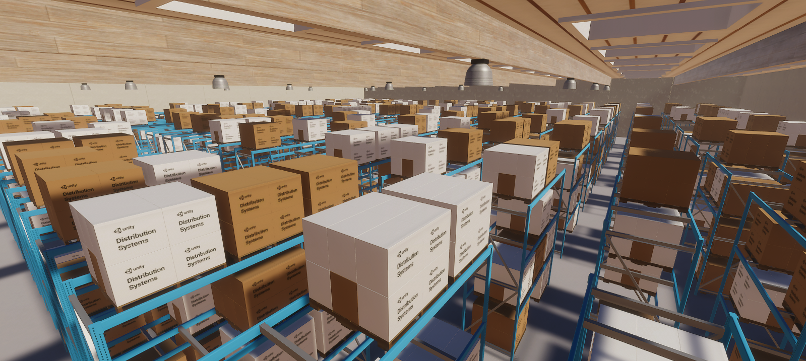
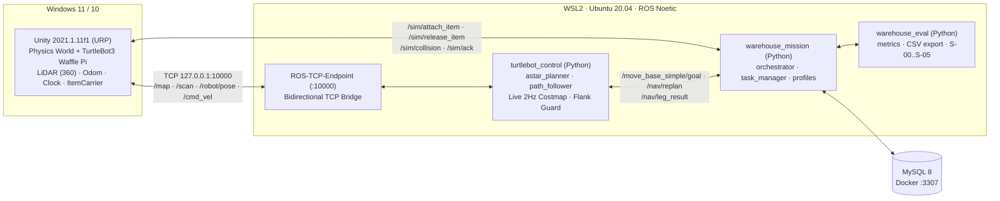

# UC6 Warehouse Robot (Mobile_Robo_SuppliesChain)



A comprehensive autonomous warehouse logistics robotics simulation built in **Unity 2021 (URP)** on Windows and powered by **ROS 1 Noetic custom Python navigation nodes** running in **WSL2 (Ubuntu 20.04)**. A physical **TurtleBot3 Waffle Pi** robot autonomously navigates warehouse aisles, avoids static and dynamic obstacles with real-time costmap inflation, picks up cargo from target shelves, and delivers it to drop-off stations.

> **Architecture Principle:** Unity is the physical body & world, ROS is the autonomous brain, MySQL is the database log.



---

## 📑 Table of Contents

1. [Features & Capabilities](#1-features--capabilities)
2. [Prerequisites & System Requirements](#2-prerequisites--system-requirements)
3. [Step-by-Step Installation Guide](#3-step-by-step-installation-guide)
4. [Quick Start (1-Click Run)](#4-quick-start-1-click-run)
5. [Interactive Testing & Obstacle Avoidance Demo](#5-interactive-testing--obstacle-avoidance-demo)
6. [Running Automated Tests (135/135 Unit & Integration Tests)](#6-running-automated-tests)
7. [Repository Structure](#7-repository-structure)
8. [ROS Topics & Interface Contract](#8-ros-topics--interface-contract)
9. [Troubleshooting & FAQ](#9-troubleshooting--faq)
10. [Team Workflow & Git Rules](#10-team-workflow--git-rules)

---

## 1. Features & Capabilities

- 🤖 **Physical TurtleBot3 Waffle Pi at 4x Physics Scale**: Modeled with realistic differential drive kinematics, dynamic friction, and holding brake ([ADR-010](docs/ADR-010-robot-scale.md), [ADR-011](docs/ADR-011-physics-standard.md), [ADR-015](docs/ADR-015-physical-waffle-pi-body.md)).
- 🗺️ **High-Performance Grid Planning (A\* + String Pulling)**: 8-connected A* with Octile heuristic and Bresenham line-of-sight smoothing. Never cuts corners into obstacles.
- ⚡ **Real-Time Dynamic Costmap (Live 2 Hz)**: LiDAR ranges (up to 3.5 m) are dynamically transformed, dilated, extruded into 3D solid footprints, and published to `/costmap` for real-time RViz visualization.
- 🛡️ **Anti-Scraping Flank Clearance Guard**: Adaptive inflation floor ($\ge 0.28\text{ m}$) and lateral proximity monitoring (`check_flank_obstacle`) prevent the robot chassis and wheels from brushing against obstacles during cornering.
- 🔄 **Early Automatic Replan**: Detects path blockage up to 3.5 m ahead and replans early without emergency halting.
- 📦 **Visual Cargo Lifecycle (`ItemCarrier.cs`)**: Smooth parabolic lifting animation mounts cargo onto the robot bed on `/sim/attach_item` and gently unloads it at drop-off stations on `/sim/release_item`.
- 🎛️ **1-Click Launchers**: Integrated Unity Editor Menu and Windows batch scripts eliminate the need to run manual WSL terminal commands.

---

## 2. Prerequisites & System Requirements

### Hardware Requirements
- **OS**: Windows 10 (64-bit, build 19041+) or Windows 11.
- **CPU**: Virtualization enabled in BIOS (Intel VT-x or AMD-V).
- **RAM**: 16 GB recommended (8 GB allocated to WSL2).
- **Storage**: ~30–40 GB free space on `C:`.

### Software Checklist
| Software | Required Version | Purpose |
|----------|------------------|---------|
| [Git for Windows](https://git-scm.com/download/win) | Latest | Repository management & Unity Git package resolution |
| [Unity Hub](https://unity.com/download) + **Unity Editor** | **2021.1.11f1** *(exact)* | Warehouse simulation (`WarehouseProjectURP`) |
| **WSL2** with **Ubuntu 20.04** | Ubuntu 20.04 Focal *(not 22.04/24.04)* | Linux environment for ROS 1 Noetic |
| **ROS 1 Noetic Desktop-Full** | Noetic | ROS backend, catkin, RViz |
| [Docker Desktop](https://www.docker.com/products/docker-desktop/) | Latest (with WSL integration) | MySQL 8 warehouse database (:3307) |

---

## 3. Step-by-Step Installation Guide

Follow these steps once when setting up a fresh machine.

### Step 3.1: Windows & WSL2 Setup
Open **PowerShell as Administrator**:
```powershell
# Install WSL2 with Ubuntu 20.04
wsl --install -d Ubuntu-20.04
```
*Restart Windows if prompted.*

Configure WSL memory and networking in `C:\Users\<YourUsername>\.wslconfig` (create this file if missing):
```ini
[wsl2]
networkingMode=nat
localhostForwarding=true
memory=8GB
processors=8
```
> [!IMPORTANT]
> Keep `networkingMode=nat` and `localhostForwarding=true`. This allows Unity on Windows to connect directly to `127.0.0.1:10000` inside WSL without firewall issues.

---

### Step 3.2: ROS 1 Noetic & Package Installation in WSL2
Open your **Ubuntu 20.04** terminal in WSL:

```bash
# 1. Setup ROS 1 Noetic repository
sudo sh -c 'echo "deb http://packages.ros.org/ros/ubuntu focal main" > /etc/apt/sources.list.d/ros-latest.list'
sudo apt-key adv --keyserver 'hkp://keyserver.ubuntu.com:80' --recv-key C1CF6E31E6BADE8868B172B4F42ED6FBAB17C654

# 2. Update and install ROS Noetic Desktop Full
sudo apt update
sudo apt install -y ros-noetic-desktop-full python3-rosdep python3-catkin-tools python3-catkin-pkg

# 3. Initialize rosdep
sudo rosdep init
rosdep update

# 4. Install additional runtime dependencies
sudo apt install -y python3-pymysql python-is-python3 ros-noetic-turtlebot3-description psmisc
```

---

### Step 3.3: Clone Repository & Build Catkin Workspace
In your **Windows terminal** (PowerShell or Git Bash), clone the project:
```bash
git clone https://github.com/HoNguyen17/Mobile_Robo_SuppliesChain.git
cd Mobile_Robo_SuppliesChain
```

Now open **WSL2 (Ubuntu 20.04)** and set up the ROS catkin workspace:
```bash
# 1. Create workspace directory
mkdir -p ~/nav_ws/src
cd ~/nav_ws/src

# 2. Symlink the repository's ROS packages into ~/nav_ws/src
# Replace the path below with your actual Windows clone path under /mnt/
ln -s "/mnt/d/Project/Mobile_Robo_SuppliesChain/ros1/turtlebot_control" .
ln -s "/mnt/d/Project/Mobile_Robo_SuppliesChain/ros1/warehouse_bringup" .
ln -s "/mnt/d/Project/Mobile_Robo_SuppliesChain/ros1/warehouse_mission" .
ln -s "/mnt/d/Project/Mobile_Robo_SuppliesChain/ros1/warehouse_eval" .

# 3. Clone ROS-TCP-Endpoint (v0.7.0)
git clone -b v0.7.0 https://github.com/Unity-Technologies/ROS-TCP-Endpoint.git

# 4. Make all Python node scripts executable
chmod +x turtlebot_control/scripts/*.py
chmod +x warehouse_mission/scripts/*.py
chmod +x warehouse_eval/scripts/*.py

# 5. Build the catkin workspace
cd ~/nav_ws
source /opt/ros/noetic/setup.bash
catkin_make

# 6. Source setup.bash automatically on terminal launch
echo "source /opt/ros/noetic/setup.bash" >> ~/.bashrc
echo "source ~/nav_ws/devel/setup.bash" >> ~/.bashrc
source ~/.bashrc
```

---

### Step 3.4: Start MySQL Database in Docker
In a Windows terminal (or WSL):
```bash
cd Mobile_Robo_SuppliesChain/infra
cp .env.example .env
docker compose up -d
```
Verify the container is healthy:
```bash
docker compose ps
# MySQL will be accessible on localhost:3307
```

---

### Step 3.5: Open Unity Project
1. Open **Unity Hub** $\to$ click **Add** $\to$ select the folder `WarehouseProjectURP`.
2. Ensure Editor version is **`2021.1.11f1`**.
3. Let Unity perform its first import (it resolves ROS-TCP-Connector `v0.7.0` and URDF-Importer `v0.5.2` from `Packages/manifest.json`).
4. In Unity Project browser, open the scene:
   `Assets/Scenes/Warehouse.unity`
5. Verify ROS Settings under menu: **Robotics $\to$ ROS Settings**:
   - Protocol: `ROS1`
   - ROS IP Address: `127.0.0.1`
   - ROS Port: `10000`

---

## 4. Quick Start (1-Click Run)

You have two convenient ways to run the complete simulation:

### Method A: Directly from Unity Editor (Recommended)
1. In Unity Editor's top menu bar, click:
   **`Robotics > Warehouse > 1. Launch ROS System & RViz (WSL)`**
   *(This automatically cleans stale processes, starts ROS master, ROS-TCP-Endpoint on port 10000, A\* Planner, Path Follower, and opens RViz in WSL).*
2. In Unity, press the **Play** button (▶️).
   *(The HUD arrows in the top-left corner turn blue, indicating a connected TCP bridge).*
3. In Unity Editor's menu, click:
   **`Robotics > Warehouse > 2. Start Mission Node (WSL)`**
   *(The robot starts autonomous dispatch: drives to target shelf, attaches cargo box, returns to drop-off station, and unloads).*
4. When finished, click:
   **`Robotics > Warehouse > 3. Clean Stop All ROS (WSL)`**

---

### Method B: Using Windows Batch Files
In the root directory of the project, double-click:
1. Double-click [`start_ros.bat`](file:///d:/Project/Mobile_Robo_SuppliesChain/start_ros.bat) $\to$ Launches ROS Backend & RViz.
2. In Unity, press **Play**.
3. Double-click [`start_mission.bat`](file:///d:/Project/Mobile_Robo_SuppliesChain/start_mission.bat) $\to$ Starts mission execution.
4. When done, double-click [`stop_ros.bat`](file:///d:/Project/Mobile_Robo_SuppliesChain/stop_ros.bat) $\to$ Cleans up all WSL background processes.

---

## 5. Interactive Testing & Obstacle Avoidance Demo

The environment includes interactive testing capabilities for dynamic obstacle avoidance:

### 🎮 How to Test Obstacle Avoidance
1. Start the simulation and press **Play** in Unity.
2. **Drop an Obstacle Directly Ahead**:
   - Press hotkey **`O`** or **`0`** on your keyboard: A bright red hazard obstacle box drops 2.5 m directly in front of the robot.
3. **Freely Move the Obstacle with Mouse**:
   - In Unity's Scene view, click the pre-placed **`Dynamic_Draggable_Obstacle`** (red cube).
   - Use Unity's **Move Tool (hotkey `W`)** to drag the box anywhere across the corridor.
4. **Observe Autonomous Avoidance in Action**:
   - **Real-Time Costmap Inflation**: In RViz, watch the obstacle immediately inflate with a bright costmap buffer at 2 Hz.
   - **Early Automatic Replanning**: The planner detects the obstruction up to 3.5 m away and generates a wide, smooth green bypass route.
   - **Anti-Scraping Flank Guard**: As the robot bypasses the box, lateral proximity monitoring maintains safe chassis clearance ($\ge 28\text{ cm}$), ensuring zero physical collisions or scraping.

---

## 6. Running Automated Tests

All core algorithms are covered by comprehensive unit, integration, and closed-loop tests:

In WSL (Ubuntu 20.04), run:
```bash
source /opt/ros/noetic/setup.bash && source ~/nav_ws/devel/setup.bash
cd ~/nav_ws/src
python3 -m unittest discover -s turtlebot_control/test && \
python3 -m unittest discover -s warehouse_mission/test && \
python3 -m unittest discover -s warehouse_eval/test
```

**Expected Result:**
```text
Ran 121 tests in 4.8s (turtlebot_control: A* planner, tracker, lateral flank guard, closed loop) - OK
Ran 12 tests in 1.6s (warehouse_mission: task manager, motion profile, orchestrator) - OK
Ran 2 tests in 0.01s (warehouse_eval: metrics collector, CSV report exporter) - OK
----------------------------------------------------------------------
Total: 135 tests passed, 0 failures, 0 errors!
```

---

## 7. Repository Structure

```text
Mobile_Robo_SuppliesChain/
├── README.md                                  # You are here (complete setup & user guide)
├── start_ros.bat                              # 1-Click launcher: ROS Backend & RViz
├── start_mission.bat                          # 1-Click launcher: Autonomous Mission
├── stop_ros.bat                               # 1-Click stopper: Clean WSL ROS shutdown
├── docs/                                      # PRD, Architecture, ADRs, Test Plan
│   ├── LOOP_PROGRESS.md                       # Iteration development & optimization logs
│   ├── setup-windows-wsl.md                   # Extended WSL2 setup troubleshooting
│   └── architecture.md                        # Detailed architecture & sequence diagrams
├── infra/                                     # Database Infrastructure
│   ├── docker-compose.yml                     # MySQL 8 service definition (:3307)
│   └── .env.example                           # Sample database credentials
├── ros1/                                      # ROS 1 Catkin Packages (Built in WSL)
│   ├── turtlebot_control/                     # A* planner, path follower, flank guard
│   │   ├── scripts/astar_planner.py           # Real-time costmap inflation & path replanner
│   │   ├── scripts/path_follower.py           # Lookahead follower with lateral repulsion
│   │   ├── scripts/path_tracker.py            # Pure pursuit & flank proximity checker
│   │   └── test/                              # 121 unit & closed-loop tests
│   ├── warehouse_bringup/                     # Launch configuration
│   │   ├── launch/bringup.launch              # Master launchfile (endpoint, planner, rviz)
│   │   └── rviz/bringup.rviz                  # Pre-configured RViz display setup
│   ├── warehouse_mission/                     # Mission Orchestration
│   │   └── scripts/mission_node.py            # High-level state machine & task dispatch
│   └── warehouse_eval/                        # Benchmarking & Scenario Evaluation
│       └── scripts/run_scenario.py            # Automated evaluation runner (S-00..S-05)
└── WarehouseProjectURP/                       # Unity 2021.1.11f1 Project (Windows)
    ├── Assets/
    │   ├── Scenes/Warehouse.unity             # Primary warehouse simulation scene
    │   ├── Scripts/Ros/
    │   │   ├── Editor/RosBridgeSetupMenu.cs   # Unity Editor 1-Click Launch Menu
    │   │   ├── ItemCarrier.cs                 # Smooth cargo pickup & dropoff animator
    │   │   ├── ScenarioLoader.cs              # Dynamic obstacle spawner & hotkey handler
    │   │   ├── PathVisualizer.cs              # Green trajectory line visualizer
    │   │   ├── LaserScanPublisher.cs          # 360-degree LiDAR raycaster
    │   │   └── RobotPosePublisher.cs          # Ground-truth TF/Pose publisher
    │   └── Resources/ROSConnectionPrefab.prefab # Endpoint connection configuration (127.0.0.1:10000)
    └── Packages/manifest.json                 # Pinned ROS-TCP-Connector & URDF-Importer
```

---

## 8. ROS Topics & Interface Contract

| Topic | Type | Source | Description |
|-------|------|--------|-------------|
| `/clock` | `rosgraph_msgs/Clock` | Unity | Simulation time published at 50 Hz |
| `/robot/pose` | `geometry_msgs/PoseStamped` | Unity | Robot ground-truth pose in map frame |
| `/map` | `nav_msgs/OccupancyGrid` | Unity | Static warehouse grid map (0.05 m resolution) |
| `/scan` | `sensor_msgs/LaserScan` | Unity | 360-degree LiDAR scanner (0.12 m – 3.5 m) |
| `/cmd_vel` | `geometry_msgs/Twist` | ROS | Velocity command driving differential wheels |
| `/costmap` | `nav_msgs/OccupancyGrid` | ROS | Live dynamic costmap with 3D obstacle dilation (2 Hz) |
| `/planned_path` | `nav_msgs/Path` | ROS | Smoothed A* trajectory waypoints |
| `/move_base_simple/goal`| `geometry_msgs/PoseStamped` | ROS | Navigation target destination |
| `/nav/replan` | `std_msgs/Empty` | ROS | Early dynamic obstacle replan trigger |
| `/nav/leg_result` | `std_msgs/String` | ROS | Leg completion outcome (`succeeded`, `aborted`) |
| `/sim/attach_item` | `std_msgs/Int32` | ROS | Command to lift cargo onto robot bed |
| `/sim/release_item` | `std_msgs/Empty` | ROS | Command to deliver cargo at drop-off station |
| `/sim/ack` | `std_msgs/String` | Unity | Acknowledgment for cargo attachment/release |

---

## 9. Troubleshooting & FAQ

### Q1: `OSError: [Errno 98] Address already in use (port 10000)`
- **Cause**: A previous ROS launch process is still lingering in the background.
- **Solution**:
  - In Unity, click **`Robotics > Warehouse > 3. Clean Stop All ROS (WSL)`**, or
  - Double-click [`stop_ros.bat`](file:///d:/Project/Mobile_Robo_SuppliesChain/stop_ros.bat), or
  - In WSL run: `killall -9 rosmaster roslaunch python3 rviz gzserver 2>/dev/null`.

### Q2: RViz window does not appear on Windows
- **Cause**: WSLg display forwarding is disabled or X11 server is missing.
- **Solution**: On Windows 11, WSLg is built-in. If on Windows 10, install [VcXsrv](https://sourceforge.net/projects/vcxsrv/) or launch with `rviz:=false` in `bringup.launch` if visual inspection is not required.

### Q3: Line endings error in WSL (`/bin/bash^M: bad interpreter`)
- **Cause**: Git on Windows converted shell scripts to CRLF endings.
- **Solution**: In WSL run:
  ```bash
  sudo apt install -y dos2unix
  dos2unix ~/nav_ws/src/turtlebot_control/scripts/*.py
  dos2unix ~/nav_ws/src/warehouse_mission/scripts/*.py
  ```

### Q4: HUD connection arrows in Unity remain red
- **Cause**: ROS backend is not running or Windows firewall blocked port 10000.
- **Solution**: Check connection in Windows PowerShell:
  ```powershell
  Test-NetConnection 127.0.0.1 -Port 10000
  ```
  Ensure `start_ros.bat` or Unity menu `1. Launch ROS System & RViz` was executed first.

---

## 10. Team Workflow & Git Rules

- **Branching**: Develop features in branch `nguyen`, then merge into `main` after verifying automated tests pass.
- **Unity Scenes**: `Assets/Scenes/Warehouse.unity` is binary-like and merges poorly. Always notify the team before editing the scene file.
- **Ignored Files**: Never commit `infra/.env`, `WarehouseProjectURP/Library/`, `Temp/`, or `Logs/` (already configured in `.gitignore`).
- **Commits**: Use conventional commits (`feat: ...`, `fix: ...`, `docs: ...`, `test: ...`).

---

## 📄 License

This project is licensed under the Apache License 2.0. The warehouse assets are adapted from [Unity-Technologies/Robotics-Warehouse](https://github.com/Unity-Technologies/Robotics-Warehouse). TurtleBot3 CAD and descriptions are courtesy of [ROBOTIS](https://github.com/ROBOTIS-GIT/turtlebot3).
